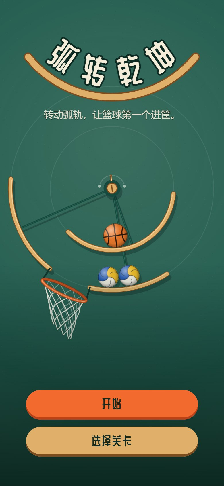
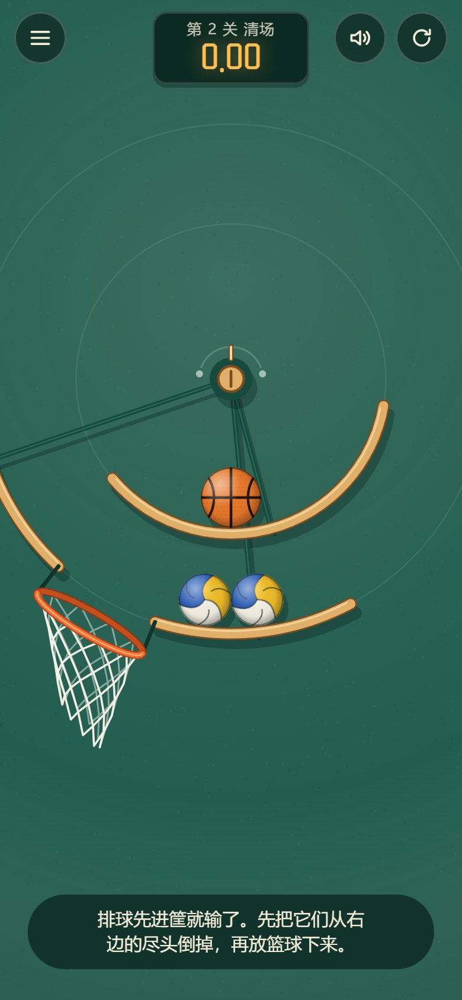
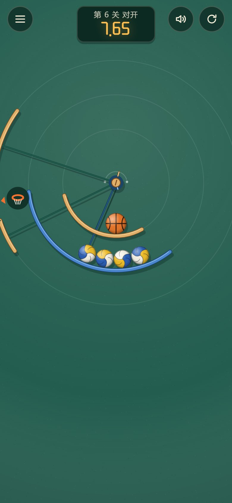
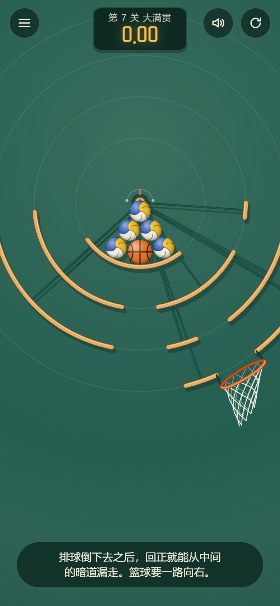

# 弧转乾坤

转动弧轨，让篮球第一个进筐。一个靠重力、惯性和碰撞说话的物理小游戏。

在线试玩：<https://only-basketball.dengjiabei.cn>（手机上可以"添加到主屏幕"，全屏玩）

<p>
  
  
  
  
</p>

## 怎么玩

- 一组弧形轨道绕着同一个轴心转动。**左右拖动**屏幕（或按键盘 ← →，按住 Shift 微调）就能转动它们。
- 球只受重力：轨道在球底下滑过去，球留在最低处打转；缺口或轨道尽头转到球的正下方，球就掉到下一层。
- 一堆球里只有一个篮球，其余都是排球。**篮球第一个穿过篮筐才算赢**；排球先进、或者篮球掉出界，都算输。
- 轨道尽头下面要是没有东西接着，那就是"悬崖"——把挡路的排球从那儿倒掉。
- 蓝色的轨道朝相反方向转。
- 用时越短星越多，最好成绩存在浏览器本地。

灵感来自短视频里见过的同类转盘玩法；这里的名字、画面、关卡和物理引擎都是自己做的。

## 本地开发

```bash
npm install
npm run dev      # 开发服务器
npm test         # 物理、规则、关卡三组测试
npm run build    # 类型检查 + 构建到 dist/
npm run deploy   # 构建并发布到 Cloudflare Workers（静态资源）
```

需要 Node 22.15 以上（实验台直接用 Node 运行 TypeScript 源码）。

## 物理是怎么做的

没有用现成的物理引擎，`src/physics/world.ts` 是为这个玩法专门写的：

- **形状只有圆球、圆弧和圆点**，碰撞检测全部用解析几何：球心到圆弧中心线的最近点是精确算出来的，
  所以球在弧轨上滚动没有折线拼接的颠簸；弧轨两端是圆头，球会顺着圆头滚落。
- **求解器**是小步长加软约束的顺序冲量法（思路同 Box2D v3 的 soft step）：每秒 480 个子步，
  每个子步重新检测碰撞，带热启动、库仑摩擦、滚动阻力和反弹。
- **球是空心球**（转动惯量 2/3·mr²）。轨道突然加速时，纯滚动的球只获得 40% 的加速度，
  所以球会"滞后"于轨道——这就是玩起来的惯性手感。
- 篮球比排球更大更重（0.62 kg 对 0.27 kg），砸下来会把排球挤开。
- 轨道是运动学物体：接触点处轨道表面的速度参与摩擦计算，转得快会把球带起来，急停会让球继续往前滚。

`tests/physics.test.ts` 把这些性质和理论值对过账：自由落体、恢复系数对应的反弹高度、
碗里纯滚动的摆动周期 `T = 2π√((1+k)L/g)`（误差小于 1.5%）、40% 惯性规律、堆叠稳定、高速不穿透等。

## 声音

没有音频文件，全部用 WebAudio 现场合成（`src/audio.ts`）。音量不是凭感觉定的：
`tools/audio-probe.js` 会把每个音效离线渲染出来，量峰值和响度。靠它发现并修掉了两个问题——
一堆球同时落地时好几个撞击声叠加会破音（现在逐个减弱并加了软限幅）；撞击声原先只有 300Hz
以下的闷响，手机的小扬声器基本发不出来（现在加了一层中频的"笃"声）。

## 关卡是怎么设计的

所有静止的球都待在各自轨道的最低点，所以整个局面可以看成一张"条形码"：
每圈轨道哪些角度有轨、哪些角度是洞。转动转盘相当于让所有球一起在各自的条形码上平移，
球走到洞上就掉到下一圈。在这个模型上有几条规律，关卡就是围绕它们搭的：

- **洞总是从一侧靠近一排球**，最靠那一侧的球先掉。
- **后掉下来的球落在"下落一侧"**。如果下一个出口也在同一侧，后来的球反而排在最前面。
- **悬崖**：轨道尽头下面没有别的轨道，掉下去就出界。
- **暗道**：上下几圈在同一个角度都有缺口，球一路漏到底。
- **反向轨道**：条形码朝相反方向平移。

`tools/lab.ts` 是设计关卡用的实验台，可以画出条形码、按脚本操作转盘并打印每个球的去向：

```bash
node --import ./tools/register.mjs tools/lab.ts 4          # 第 4 关：按参考解法走一遍
node --import ./tools/register.mjs tools/lab.ts 4 sweep    # 不动脑筋一路转到底，会怎样？
node --import ./tools/register.mjs tools/lab.ts 4 robust   # 参考解法放慢 / 加快还能不能过
node --import ./tools/register.mjs tools/lab.ts 4 fuzz     # 模拟手抖（转速 ±25%、随机停顿）跑 20 局的胜率
```

每一关的参考解法在 `tools/scripts.ts`，`tests/levels.test.ts` 会逐关回放，
保证关卡可解、三星可达，并且解法经得起手抖。

## 目录

```
src/physics/   物理引擎
src/game/      规则（进球、出界、胜负、计时）与关卡表
src/render/    Canvas 渲染：墙面、弧轨、球、篮筐、球网（Verlet 绳网）、粒子
src/audio.ts   音效，全部用 WebAudio 现场合成
src/input.ts   拖动手势（多指接管）
src/app.ts     界面流程、主循环
tools/         关卡实验台、参考解法、音效体检、字体子集化脚本
tests/         测试
```

## 字体

标题字用的是站酷庆科黄油体（ZCOOL QingKe HuangYou），SIL OFL 1.1 授权，授权全文见
`public/fonts/OFL.txt`。仓库里只放了界面用到的那些字的子集；文案有增减后重新生成：

```bash
node tools/subset-font.mjs <ZCOOLQingKeHuangYou-Regular.ttf 的路径>
```
